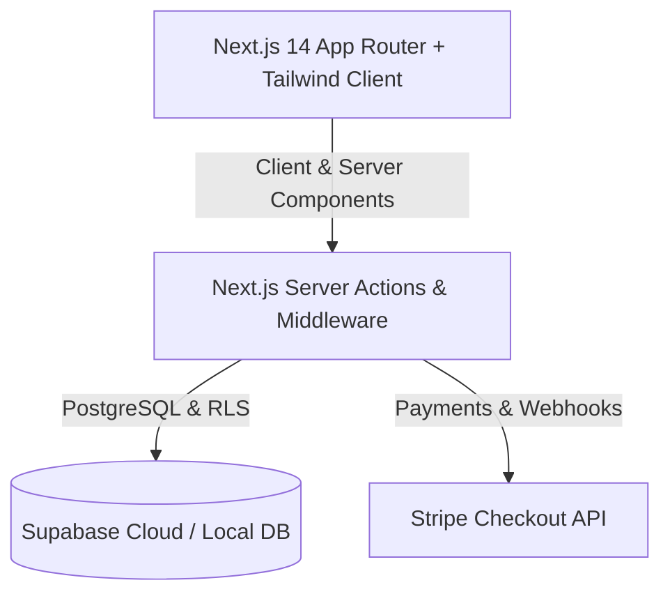

# ⚡ FreelanceFLOW — Financial Operations & Invoicing Platform for Freelancers

[](https://nextjs.org/)
[](https://supabase.com/)
[](https://www.typescriptlang.org/)
[](https://tailwindcss.com/)
[](https://opensource.org/licenses/MIT)

**FreelanceFLOW** is an all-in-one financial dashboard and invoicing workspace engineered for independent contractors, agencies, and freelance professionals. It unifies client CRM, invoice dispatch, expense categorization, revenue projections, and automated CSV/Excel accounting exports.

---

## 🌟 Key Features

- **🧾 Full Invoice Lifecycle:** Draft, send, mark paid, cancel, or duplicate invoices with automatic multi-currency conversion (USD, EUR, GBP, CAD, AUD, DZD).
- **📊 Real-Time Financial Analytics:** Visual revenue breakdown, paid vs. overdue tracking, and monthly growth metrics.
- **📁 Expense & Tax Categorization:** Track business deductibles, upload receipts, and categorize expenditures.
- **👥 Client CRM:** Keep complete client records, historical billed amounts, contact persons, and individual invoice history.
- **📑 Multi-Format Exporting:** 1-Click export of invoice registers and expense logs to **CSV** and **Excel (.xlsx)** format.
- **🔐 Secure Authentication & Storage:** Powered by **Supabase Auth & PostgreSQL Row-Level Security (RLS)**.

---

## 🏗️ Architecture



---

## 🚀 Quickstart Guide

### Prerequisites
- Node.js 18.x+
- A free [Supabase](https://supabase.com) account

### Setup Steps

```bash
# 1. Clone the repository
git clone https://github.com/younesBH13/freelanceflow-saas.git
cd freelanceflow-saas

# 2. Install dependencies
npm install

# 3. Configure Environment Variables
cp .env.example .env.local
# Add your NEXT_PUBLIC_SUPABASE_URL and NEXT_PUBLIC_SUPABASE_ANON_KEY

# 4. Apply Database Migrations
# Run the SQL scripts in supabase/migrations/ on your Supabase SQL Editor

# 5. Launch the application
npm run dev
```

Open **`http://localhost:3000`** in your browser.

---

## 📂 Project Structure

```
freelanceflow-saas/
├── app/
│   ├── auth/                # Login, Signup, Forgot Password flows
│   ├── dashboard/           # Main executive analytics & KPIs
│   │   ├── clients/         # Client management CRM
│   │   ├── expenses/        # Business expenditure tracking
│   │   ├── invoices/        # Invoice generator & detail viewer
│   │   └── settings/        # Currency & profile customization
│   └── api/stripe/          # Stripe webhooks & checkout endpoints
├── components/              # Dashboard layout, Search & Notification modals
├── lib/supabase/            # Supabase SSR client & middleware
├── supabase/migrations/     # Database tables, triggers & RLS policies
└── README.md
```

---

## 📄 License
This project is licensed under the MIT License — see the [LICENSE](LICENSE) file for details.
